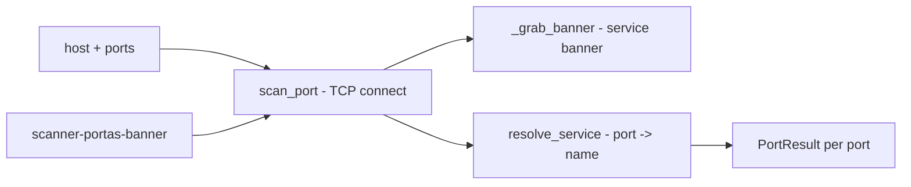

# scanner-portas-banner

**English** · [Português (Brasil)](README.md)

[](#) [](#) [](LICENSE)

## What it is

**A TCP port scanner with banner grabbing**: it connects to ports on a target, identifies the **service** by well-known port, **grabs the service banner** (when available) and reports open/closed ports. It is an educational security lab in pure Python (socket/stdlib).

## ⚠️ Ethical and legal use warning

Use it **only on your own networks and hosts** or with the responsible party's express authorisation. Port scanning third-party systems without permission may be illegal (unauthorised vulnerability scanning).

## Status

An educational lab, working and tested (5 tests).

## Features

- **Port scan** (`scan_port`): a TCP connect to host:port with timeout; returns a `PortResult` (open/closed).
- **Banner grabbing** (`_grab_banner`): reads the service banner after connecting (when the service sends one).
- **Service resolution** (`resolve_service`): the well-known service name for a port (e.g. 80→http, 22→ssh).
- **Range scanning** (`scan_ports`): applies the scan to a list of ports.
- **CLI**: `scanner-portas-banner [host] --ports 80,443,1000-2000 [--timeout S]` (host default 127.0.0.1, ports default 1-1024).

## Architecture

A `scanner_portas_banner` package with `scanner.py` (scan + banner) and `__main__.py` (CLI, port-spec parsing).



## Stack

- Python ≥ 3.10, stdlib only (socket)
- pytest (dev)

## Repository layout

```
scanner-portas-banner/
├── pyproject.toml · BRIEF.md
├── src/scanner_portas_banner/
│   ├── scanner.py    # scan + banner + service
│   └── __main__.py   # CLI
├── tests/            # 5 tests
└── LICENSE           # MIT
```

## Prerequisites and installation

```bash
pip install -e .
```

## How to run

```bash
scanner-portas-banner 127.0.0.1 --ports 80,443,8080 --timeout 2
```

## Tests and quality

Real command (verified by the agent):

```bash
PYTHONPATH=src python -m pytest tests/
# 5 passed
```

## Technical decisions and trade-offs

- **Simple connect scan**: one TCP connect per port — direct and didactic; noisier than a SYN scan and no parallelism.
- **Optional banner grab**: extra version/service identification; not every service sends a banner.

## Known limitations and roadmap

- Sequential scanning (no threads/asyncio) — slow for large ranges.
- No firewall/IDS detection, no UDP scanning.

## Development process

An individual project by Kelvin Oliveira, built with orchestrated AI agents and reviewed by the author.

## License and author

MIT — Copyright (c) 2026 Kelvin Rebelo de Oliveira. Author: [Kelvin Oliveira](https://github.com/KelvinOliveiraCode) · [Portfolio](https://kelvinoliveiracode.github.io/portfolio/)
