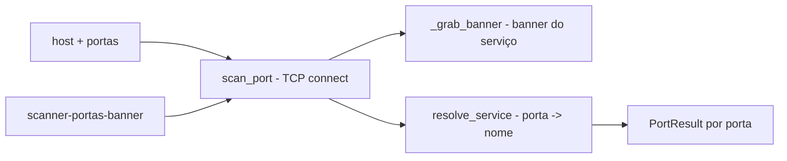

# scanner-portas-banner

[English](README.en.md) · **Português (Brasil)**

[](#) [](#) [](LICENSE)

## O que é

**Scanner de portas TCP com captura de banner**: conecta em portas de um alvo, identifica o **serviço** por porta conhecida, **captura o banner** do serviço (quando disponível) e reporta portas abertas/fechadas. É um laboratório educacional de segurança em Python puro (socket/stdlib).

## ⚠️ Aviso de uso ético e legal

Use **apenas em redes e hosts próprios** ou com autorização expressa do responsável. Varredura de portas em sistemas de terceiros sem permissão pode ser ilegal (vulnerability scanning não autorizado).

## Status

Laboratório educacional funcional e testado (5 testes).

## Funcionalidades

- **Scan de porta** (`scan_port`): conecta TCP em host:porta com timeout; retorna `PortResult` (aberta/fechada).
- **Captura de banner** (`_grab_banner`): lê o banner do serviço após conectar (quando o serviço o envia).
- **Resolução de serviço** (`resolve_service`): nome do serviço conhecido pela porta (ex.: 80→http, 22→ssh).
- **Varredura de faixa** (`scan_ports`): aplica o scan a uma lista de portas.
- **CLI**: `scanner-portas-banner [host] --ports 80,443,1000-2000 [--timeout S]` (host default 127.0.0.1, portas default 1-1024).

## Arquitetura

Pacote `scanner_portas_banner` com `scanner.py` (scan + banner) e `__main__.py` (CLI, parse da spec de portas).



## Stack

- Python ≥ 3.10, stdlib apenas (socket)
- pytest (dev)

## Estrutura do repositório

```
scanner-portas-banner/
├── pyproject.toml · BRIEF.md
├── src/scanner_portas_banner/
│   ├── scanner.py    # scan + banner + serviço
│   └── __main__.py   # CLI
├── tests/            # 5 testes
└── LICENSE           # MIT
```

## Pré-requisitos e instalação

```bash
pip install -e .
```

## Como executar

```bash
scanner-portas-banner 127.0.0.1 --ports 80,443,8080 --timeout 2
```

## Testes e qualidade

Comando real (verificado pelo agente):

```bash
PYTHONPATH=src python -m pytest tests/
# 5 passed
```

## Decisões técnicas e trade-offs

- **Connect scan simples**: um TCP connect por porta — direto e didático; mais ruidoso que SYN scan e sem paralelismo.
- **Banner grab opcional**: identificação extra de versão/serviço; nem todo serviço envia banner.

## Limitações conhecidas e roadmap

- Scan sequencial (sem threads/asyncio) — lento para faixas grandes.
- Sem detecção de firewall/IDS, sem varredura UDP.

## Processo de desenvolvimento

Projeto individual de Kelvin Oliveira, construído com agentes de IA orquestrados e revisado pelo autor.

## Licença e autor

MIT — Copyright (c) 2026 Kelvin Rebelo de Oliveira. Autor: [Kelvin Oliveira](https://github.com/KelvinOliveiraCode) · [Portfólio](https://kelvinoliveiracode.github.io/portfolio/)
